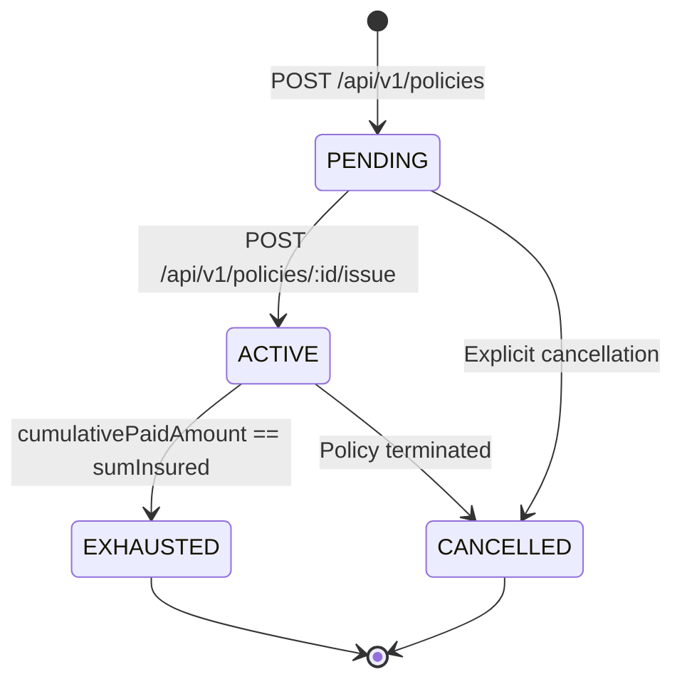
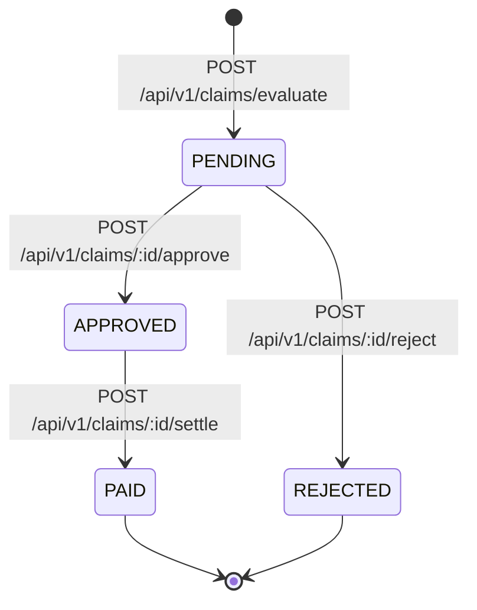

# AgriShield Module 9: Parametric Underwriting, Policy & Automated Claims Domain

## Architectural Specification & Operational Reference

---

## 1. Executive Summary & Objective

**Module 9** delivers the core financial and insurance automation engine of the AgriShield platform: **Parametric Crop Insurance Underwriting, Policy Management, and Automated Claim Adjudication**.

In traditional indemnity insurance, claim settlements require manual on-site loss assessments by adjusters, which often incur weeks or months of administrative friction, subjective loss estimates, and delayed farmer compensation. AgriShield eliminates this friction through **algorithmic, objective parametric insurance**:
1. **Objective Triggers:** Pre-agreed, legally binding thresholds monitored automatically from immutable physical telemetry (such as IMD weather stations).
2. **Deterministic Adjudication:** Claims are evaluated strictly against verified breach events produced by the authoritative Module 6 Climate Risk Rule Engine.
3. **Simulated Real-Time Settlement:** Pre-authorized indemnity payouts are executed directly within ACID transactional boundaries, updating policy balances and issuing simulated disbursement references (`SIM-PAYOUT-*`) with zero manual human adjustment required.

---

## 2. System Architecture & Layered Boundaries

Module 9 follows Clean Architecture principles, ensuring strict decoupling between routing, controllers, domain services, data repositories, and the database persistence layer.

```
                  ┌─────────────────────────────────────────────────────────┐
                  │                 Farmer / Underwriter                    │
                  └────────────────────────────┬────────────────────────────┘
                                               │
                                               ▼
┌───────────────────────────────────────────────────────────────────────────────────────────┐
│ Client Presentation Layer (Module 9.5)                                                    │
│  • FarmPolicyClaimsSection.tsx   • PolicyCard.tsx         • ClaimHistoryTable.tsx         │
│  • ClaimAuditModal.tsx           • PolicyStatusBadge.tsx  • ClaimStatusBadge.tsx          │
│  • policyClaimService.ts         (Axios HTTP Client, zero client-side financial mutation) │
└──────────────────────────────────────────────┬────────────────────────────────────────────┘
                                               │ HTTP / REST (JWT Bearer Auth)
                                               ▼
┌───────────────────────────────────────────────────────────────────────────────────────────┐
│ API Gateway & Controller Layer (Module 9.4)                                               │
│  • policy.routes.ts              • claim.routes.ts                                        │
│  • policy.controller.ts          • claim.controller.ts                                    │
│  • authenticateJwt               • authorizeFarmAccess (BOLA / IDOR ownership validation) │
│  • Zod Validation Middleware     (createPolicySchema, evaluateClaimSchema, etc.)          │
└──────────────────────────────────────────────┬────────────────────────────────────────────┘
                                               │
                                               ▼
┌───────────────────────────────────────────────────────────────────────────────────────────┐
│ Domain Business Logic Services (Module 9.3)                                               │
│  • PolicyService                 • ClaimService                                           │
│  - Boundary eligibility check    - Rule breach verification                               │
│  - Active farm validation        - Coverage window verification                           │
│  - Overlap prevention            - Multiplier bracket application                         │
│  - Policy issuance lifecycle     - Remaining-coverage capping                             │
│                                  - Simulated disbursement generation                      │
└──────────────────────────────────────────────┬────────────────────────────────────────────┘
                                               │
                                               ▼
┌───────────────────────────────────────────────────────────────────────────────────────────┐
│ Persistence & Concurrency Layer (Module 9.1 & 9.2)                                        │
│  • policy.repository.ts          • claim.repository.ts                                    │
│  - Row-Level Locking             - SELECT "id" FROM "policies" ... FOR UPDATE             │
│  - Foreign Key Isolation         - Restrict on delete to protect financial ledgers        │
│  - Compound Idempotency Key      - @@unique([policyId, riskEventId])                      │
└──────────────────────────────────────────────┬────────────────────────────────────────────┘
                                               │
                                               ▼
┌───────────────────────────────────────────────────────────────────────────────────────────┐
│ Database Layer (PostgreSQL 16 + PostGIS)                                                  │
│  • policies table                • claims table                                           │
│  • farms table                   • risk_assessments & risk_events tables                   │
└───────────────────────────────────────────────────────────────────────────────────────────┘
```

---

## 3. Underwriting Rules & Prerequisites

Before any parametric policy can be created or activated, the system enforces strict agronomic, legal, and geospatial invariants.

### 3.1 Validated Farm-Boundary Prerequisite (Module 4 Integration)
Parametric insurance cannot function without an authoritative, legally unambiguous spatial bounding polygon:
- **Requirement:** A prospective farm parcel must possess a persisted `FarmBoundary` record in PostgreSQL (`geometry(Polygon, 4326)`).
- **Enforcement:** In `PolicyService.createPolicy`, the boundary repository is queried via `boundaryRepo.findByFarmId(farmId)`. If no boundary exists, creation is immediately rejected with HTTP 400 Bad Request:
  ```typescript
  const boundary = await this.boundaryRepo.findByFarmId(data.farmId);
  if (!boundary) {
    throw AppError.badRequest(
      `Farm parcel '${data.farmId}' lacks an established geospatial boundary. A validated boundary is required for parametric coverage.`
    );
  }
  ```
- **Rationale:** The farm boundary provides:
  1. Authoritative centroid coordinates (`centroidLatitude`, `centroidLongitude`) used to index localized weather observations.
  2. Geodesic area calculations (`calculatedAreaHectares` via `ST_Area(geom::geography)`) used to evaluate coverage density.
  3. Spatial clipping envelope (AOI) required for remote sensing (Sentinel-2 satellite NDVI passes).

### 3.2 Farm & Producer Verification (Module 2 & 3 Integration)
1. **Producer Identity:** The authenticated user (`req.user.farmerId`) must be the registered producer (`farm.farmerId === farmerId`).
2. **Active Parcel Status:** The parcel must have `farm.status === FarmStatus.ACTIVE`. Parcels that are dormant, harvested, or archived cannot obtain new insurance coverage.

### 3.3 Temporal Validation & Overlap Prevention
1. **Window Integrity:** `startDate` must be strictly before `endDate`.
2. **Overlapping Coverage Prohibition:** A single farm parcel cannot be covered by multiple overlapping active or pending policies. The system checks date-range intersection across all non-exhausted and non-cancelled policies:
   $$\text{ExistingPolicy.startDate} \le \text{NewPolicy.endDate} \quad \land \quad \text{ExistingPolicy.endDate} \ge \text{NewPolicy.startDate}$$
   If an overlap is detected, policy creation is rejected with HTTP 400.

---

## 4. Policy & Claim Lifecycles and State Machines

### 4.1 Policy State Machine



- **`PENDING`:** Initial quote state upon underwriting validation. The policy is legally drafted but has not yet collected premium or commenced risk coverage. **Claims cannot be evaluated on PENDING policies.**
- **`ACTIVE`:** Policy is issued and in effect. Eligible risk events falling within `[startDate, endDate]` can trigger claims.
- **`EXHAUSTED`:** Total indemnity disbursements (`cumulativePaidAmount`) have reached the full contract limit (`sumInsured`). The policy is automatically closed; further claim evaluations are strictly rejected.
- **`CANCELLED`:** Policy voided or cancelled.

### 4.2 Claim State Machine



- **`PENDING`:** Claim has been mathematically derived from a triggered Module 6 `RiskEvent`. **Policy balance is NOT modified at this stage.**
- **`APPROVED`:** Internal validation check passes. Confirms claim eligibility. **Policy balance remains unmodified.**
- **`PAID`:** Atomic transactional settlement executed. A simulated disbursement reference (`SIM-PAYOUT-...`) is assigned, and the policy's `cumulativePaidAmount` is incremented.
- **`REJECTED`:** Claim denied with an explicit mandatory audit explanation string.

---

## 5. Payout Calculation & Remaining-Coverage Invariants

### 5.1 Mathematical Formulation
When evaluating an eligible claim, the indemnity payout is calculated using the policy's sum insured, the event's severity tier, and the remaining coverage available:

$$\text{basePayout} = \text{sumInsured} \times \text{multiplier}(\text{RiskSeverity})$$

$$\text{remainingCoverage} = \text{sumInsured} - \text{cumulativePaidAmount}$$

$$\text{payoutAmount} = \min(\text{basePayout}, \text{remainingCoverage})$$

### 5.2 Severity Multiplier Brackets
Severity multipliers must be explicitly supplied in `payoutConfig.severityMultipliers`:
- `HIGH` severity: Typically $0.50$ ($50\%$ of sum insured).
- `VERY_HIGH` severity: Typically $0.80$ to $1.00$ ($80\%\text{--}100\%$ of sum insured).
- Multipliers must satisfy $0.0 < \text{multiplier} \le 1.0$.

### 5.3 Financial Invariants
1. **Dynamic Remaining-Coverage Cap:** Payouts never exceed remaining coverage. If a policy with $\text{sumInsured} = ₹100,000$ has already paid out $₹80,000$, a subsequent claim with a base calculation of $₹50,000$ is dynamically capped to exactly $₹20,000$.
2. **Conservation of Balance:** At all times, the persisted policy balance strictly equals the sum of all settled (`PAID`) claims:
   $$\text{policy.cumulativePaidAmount} = \sum_{c \in \text{Claims}_{\text{PAID}}} c.\text{payoutAmount} \le \text{policy.sumInsured}$$
3. **Decoupled Evaluation & Approval:** Creating or approving a claim does not alter `cumulativePaidAmount`. The balance is updated **exclusively** during transactional settlement.
4. **Exact Decimal Precision:** All financial calculations use `Prisma.Decimal` (fixed precision 2 decimal places). Float approximation is strictly prohibited.

---

## 6. Concurrency Control & Database Locking

Under concurrent settlement requests (e.g., automated parallel processing of multiple breached rules), race conditions could cause the cumulative paid amount to exceed the sum insured. AgriShield prevents this through **PostgreSQL row-level locking**:

### 6.1 Transaction Boundary & Row-Level Lock
During `POST /api/v1/claims/:id/settle`, the settlement method enters an atomic Prisma transaction (`prisma.$transaction`) and invokes `policyRepository.updatePolicyBalanceAndStatus`:

```typescript
// backend/src/repositories/policy.repository.ts
if (typeof (client as any).$queryRaw === 'function') {
  if (isUuid) {
    await (client as any).$queryRaw`SELECT "id" FROM "policies" WHERE "id" = ${id}::uuid FOR UPDATE`;
  } else {
    await (client as any).$queryRaw`SELECT "id" FROM "policies" WHERE "id" = ${id} FOR UPDATE`;
  }
}
```

### 6.2 Serialization Mechanics
1. **Exclusive Lock:** `SELECT ... FOR UPDATE` acquires an exclusive row-level lock on the target row in `policies`.
2. **Serialized Read:** The locked policy record is read fresh from the database.
3. **Capacity Check:** The system verifies that `cumulativePaidAmount + payoutIncrement <= sumInsured`.
4. **Atomic Commit:** If valid, the policy balance is incremented and the claim is updated to `PAID`. The lock is released upon transaction commit.
5. **Conflict Rejection:** Any concurrent settlement competing for the same policy is blocked until the first finishes. When the second transaction acquires the lock, it reads the updated balance; if the sum insured is exceeded, the second transaction is rejected with HTTP 400 Bad Request, guaranteeing zero financial over-commitment.

---

## 7. Database Architecture & Deletion Protections

### 7.1 Entity Relationship Diagram

```
┌─────────────────────────┐
│         farms           │
├─────────────────────────┤
│ id (UUID, PK)           │
│ farmerId (FK -> farmers)│
└────────────┬────────────┘
             │ 1
             │
             │ ON DELETE RESTRICT (Protects legal audit trail)
             │
             ▼ *
┌─────────────────────────┐                   ┌─────────────────────────┐
│        policies         │                   │      risk_events        │
├─────────────────────────┤                   ├─────────────────────────┤
│ id (UUID, PK)           │                   │ id (UUID, PK)           │
│ policyNumber (VarChar)  │                   │ assessmentId (FK)       │
│ farmId (FK -> farms)    │                   │ riskRuleId (FK)         │
│ farmerId (FK -> farmers)│                   │ severity (RiskSeverity) │
│ sumInsured (Decimal)    │                   │ triggered (Boolean)     │
│ cumulativePaid (Decimal)│                   └────────────┬────────────┘
│ status (PolicyStatus)   │                                │ 1
└────────────┬────────────┘                                │
             │ 1                                           │
             │                                             │
             │ ON DELETE RESTRICT                          │ ON DELETE RESTRICT
             │                                             │
             ▼ *                                           ▼ *
┌───────────────────────────────────────────────────────────────────────┐
│                                claims                                 │
├───────────────────────────────────────────────────────────────────────┤
│ id (UUID, PK)                                                         │
│ claimNumber (VarChar, UNIQUE)                                         │
│ policyId (UUID, FK -> policies, ON DELETE RESTRICT)                   │
│ assessmentId (UUID, FK -> risk_assessments, ON DELETE RESTRICT)       │
│ riskEventId (UUID, FK -> risk_events, ON DELETE RESTRICT)             │
│ payoutAmount (Decimal(12, 2))                                         │
│ status (ClaimStatus: PENDING, APPROVED, PAID, REJECTED)               │
│ payoutReference (VarChar, nullable, e.g. "SIM-PAYOUT-...")            │
│ paidAt (Timestamptz, nullable)                                        │
│ rejectionReason (Text, nullable)                                      │
├───────────────────────────────────────────────────────────────────────┤
│ UNIQUE CONSTRAINT: @@unique([policyId, riskEventId])                  │
└───────────────────────────────────────────────────────────────────────┘
```

### 7.2 Idempotency & Unique Constraints
- **Compound Key:** `@@unique([policyId, riskEventId], name: "policy_risk_event_unique")` guarantees that a single risk event cannot be claimed more than once on the same policy. Duplicate evaluation requests return HTTP 409 Conflict.
- **Business Number Uniqueness:** `policyNumber` and `claimNumber` are globally unique strings generated with crypto entropy.

### 7.3 Restrict Deletion Semantics
While transient data (such as raw weather readings and satellite observations) use `ON DELETE CASCADE` when a farm is removed, financial entities (`policies` and `claims`) strictly use **`ON DELETE RESTRICT`**:
- A farm with active, pending, or settled policies **cannot be deleted**.
- A policy with claims **cannot be deleted**.
- A risk event linked to a claim **cannot be deleted**.
This ensures regulatory auditability and compliance with financial record-keeping standards.

---

## 8. Cross-Module Boundaries & Decoupling

### 8.1 Authoritative Weather Rules (Module 6) vs. Advisory ML (Module 8)
- **Module 6 (Authoritative):** Evaluates deterministic IMD weather rules (e.g. `HEAVY_RAINFALL_24H`, `INTENSE_RAINFALL_3H`). Claims can **only** be created by referencing verified `risk_events` generated by Module 6.
- **Module 8 (Advisory):** Computes machine learning risk predictions (`calibrated_probability`, SHAP local feature attributions). Module 8 is **strictly advisory**:
  - ML inference results have **zero authority** to adjudicate or settle claims.
  - Submitting an ML prediction ID to `/api/v1/claims/evaluate` fails with HTTP 404/400.
  - The farmer UI displays Module 8 insights as agronomic guidance, keeping claim controls completely separate.

### 8.2 Copernicus Sentinel-2 Remote Sensing (Module 7)
- Module 7 ingests and processes multispectral imagery from Copernicus Sentinel-2 (`B04` Red, `B08` NIR) to calculate the Normalized Difference Vegetation Index (NDVI) across the parcel boundary.
- **Critical Policy Principle:** In the current system architecture, **NDVI observations do not automatically trigger claim payouts**.
  - Statutory parametric triggers currently evaluate atmospheric hazards (`HEAVY_RAINFALL`, `INTENSE_RAINFALL`, `HIGH_TEMPERATURE`, `STRONG_WIND`).
  - NDVI serves as an agronomic health metric and as an input feature for Module 8 ML risk scoring.
  - Satellite-triggered drought or vegetative deficit insurance would require explicit new statutory rule models, hazard enums, and dedicated evaluation pathways before it could be settled as a claim.

---

## 9. Verified API Contracts

### 9.1 Policy Endpoints (`/api/v1/policies`)

| Endpoint | Method | Access | Description | Request Body / Params | Expected Response (200 / 201) |
| :--- | :--- | :--- | :--- | :--- | :--- |
| `/api/v1/policies` | `POST` | Authenticated | Create policy quote (`PENDING`) | `farmId`, `farmerId`, `cropName`, `sumInsured`, `premiumAmount`, `coveredHazards`, `startDate`, `endDate` | `201 Created` with `PolicyResponseDTO` |
| `/api/v1/policies` | `GET` | Authenticated | Query policies (scoped to caller) | Query: `?farmId=<uuid>` (optional) | `200 OK` with `PolicyResponseDTO[]` |
| `/api/v1/policies/:id` | `GET` | Authenticated | Retrieve policy by ID | Param: `id` (UUID or policy number) | `200 OK` with `PolicyResponseDTO` |
| `/api/v1/policies/:id/issue` | `POST` | Authenticated | Activate policy (`ACTIVE`) | Param: `id` (UUID or policy number) | `200 OK` with `PolicyResponseDTO` (`status: ACTIVE`) |
| `/api/v1/farms/:farmId/policies` | `GET` | Authenticated (Owner) | List policies for farm | Param: `farmId` (UUID) | `200 OK` with `PolicyResponseDTO[]` |
| `/api/v1/farms/:farmId/policies/active` | `GET` | Authenticated (Owner) | Get active policy for farm | Param: `farmId` (UUID), Query: `?referenceDate=...` | `200 OK` with `PolicyResponseDTO` |

### 9.2 Claim Endpoints (`/api/v1/claims`)

| Endpoint | Method | Access | Description | Request Body / Params | Expected Response (200 / 201) |
| :--- | :--- | :--- | :--- | :--- | :--- |
| `/api/v1/claims/evaluate` | `POST` | Authenticated (Owner) | Evaluate prospective claim | `policyId`, `assessmentId`, `riskEventId`, `payoutConfig: { severityMultipliers: { ... } }` | `201 Created` with `ClaimResponseDTO` (`status: PENDING`) |
| `/api/v1/claims` | `GET` | Authenticated | Query claims (scoped to caller) | Query: `?policyId=<uuid>&farmId=<uuid>` | `200 OK` with `ClaimResponseDTO[]` |
| `/api/v1/claims/:id` | `GET` | Authenticated | Retrieve claim details | Param: `id` (UUID or claim number) | `200 OK` with `ClaimResponseDTO` |
| `/api/v1/claims/:id/approve` | `POST` | Authenticated (Owner) | Approve claim | Param: `id` (UUID or claim number) | `200 OK` with `ClaimResponseDTO` (`status: APPROVED`) |
| `/api/v1/claims/:id/settle` | `POST` | Authenticated (Owner) | Execute simulated settlement | Param: `id` (UUID), Body: `{ simulatedPayoutReference: "SIM-..." }` | `200 OK` with `ClaimResponseDTO` (`status: PAID`) |
| `/api/v1/claims/:id/reject` | `POST` | Authenticated (Owner) | Reject claim with audit reason | Param: `id` (UUID), Body: `{ reason: "..." }` | `200 OK` with `ClaimResponseDTO` (`status: REJECTED`) |
| `/api/v1/farms/:farmId/claims` | `GET` | Authenticated (Owner) | List all claims for farm | Param: `farmId` (UUID) | `200 OK` with `ClaimResponseDTO[]` |

### 9.3 Standard Response Envelope
All endpoints return standard envelopes conforming to AgriShield API standards:
```json
{
  "success": true,
  "data": { ... },
  "message": "Operation completed successfully"
}
```
Operational errors return standard error structures with sanitized messages:
```json
{
  "success": false,
  "error": {
    "code": "BAD_REQUEST",
    "message": "Payout increment of 50000.00 exceeds remaining coverage balance."
  }
}
```
